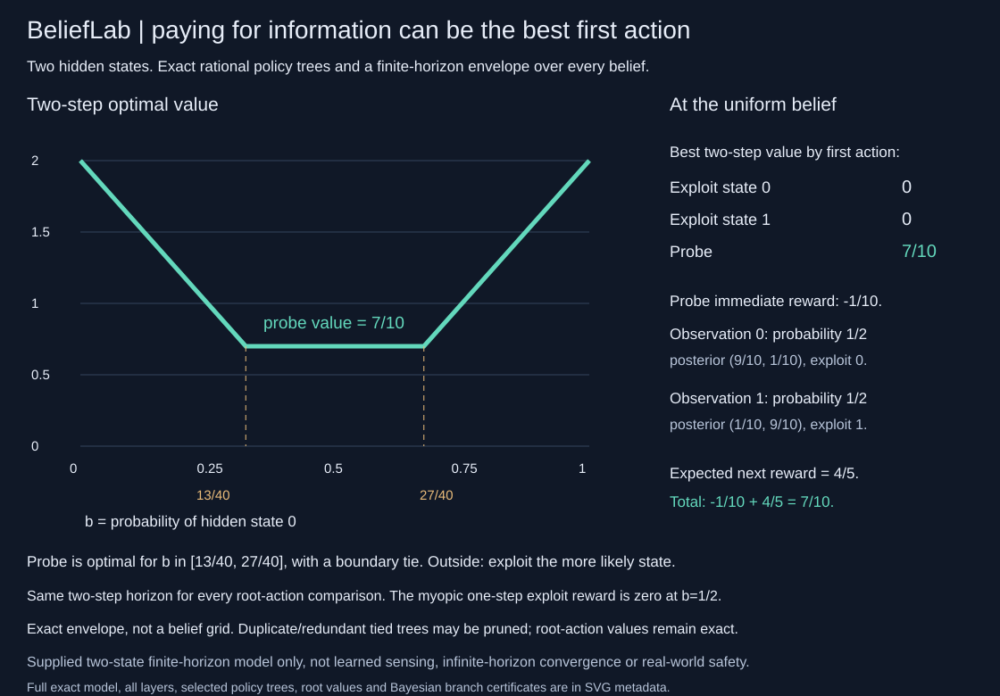
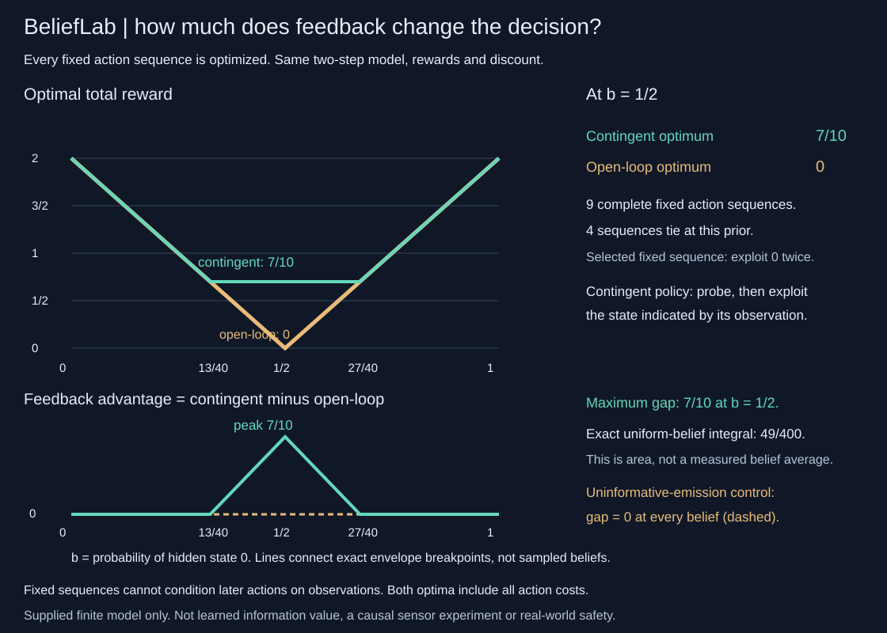
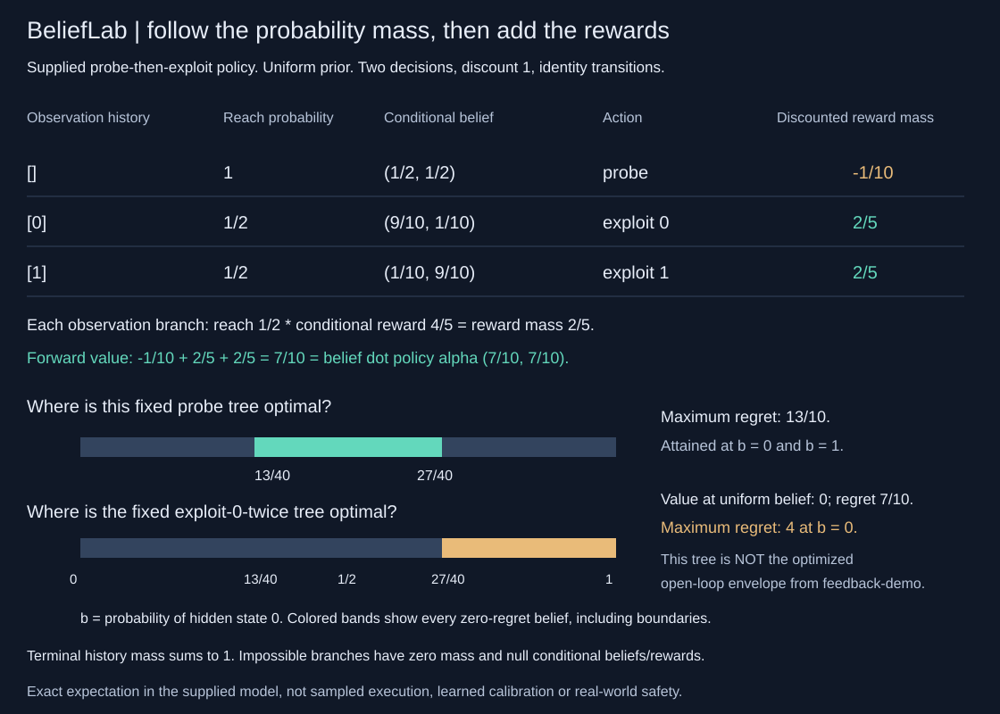
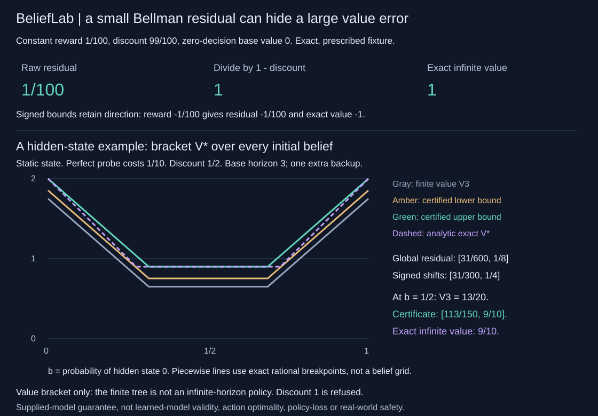

# BeliefLab

BeliefLab solves small supplied POMDPs with two hidden states and two possible
observations. Exact rational policy trees show how observations change the next
action. Compare the optimized feedback and fixed-sequence values, trace one fixed
tree's probability/reward contributions, or bracket discounted infinite value.
Python 3.10+, standard library only. No learned model or belief grid.

| Question | Start here | Boundary |
| --- | --- | --- |
| When is it worth paying to observe? | [Sensing example](#a-two-action-sensing-example) | This is a supplied-model calculation, not a sensor benchmark. |
| What does feedback add over a fixed action sequence? | [Optimized open-loop comparison](#optimized-open-loop-baseline-and-feedback-advantage) | Both optima use the same horizon, model, reward and costs. |
| What return does one particular tree earn? | [Fixed-policy audit](#execute-the-policy-witness-as-an-exact-probability-audit) | Conditional branch rewards and unconditional contributions differ. |
| How far is a finite value from the discounted optimum? | [Infinite-value bracket](#from-finite-plans-to-a-discounted-infinite-value-bracket) | The global residual bracket is not an infinite-horizon policy or action-optimality certificate. |



## A two-action sensing example

```sh
python -m belieflab demo
python -m unittest discover -s tests -v
PYTHONPATH=. python examples/render_audit.py --check
```

The directly specified model has two fixed hidden states and three actions. Exploit action 0 rewards +1 in state 0 and -1 in state 1; exploit action 1 reverses those rewards. Their observations are uninformative. Probe costs 1/10 now and reports the state correctly with probability 9/10. Transitions preserve the state. The horizon is two actions, discount one, zero terminal value and initial belief `(1/2,1/2)`.

| First action | Best total reward over the same two-action horizon |
|---|---:|
| Exploit state 0 | 0 |
| Exploit state 1 | 0 |
| Probe | 7/10 |

A myopic one-action decision picks an exploit action: immediate reward zero beats probe's -1/10. Two-action planning instead probes, then chooses the exploit action based on the observation. Each observation has probability 1/2, producing posterior `(9/10,1/10)` or `(1/10,9/10)`. The expected second reward is 4/5, so total value is `-1/10 + 4/5 = 7/10`. The root-action table above uses the same two-action horizon for every action, rather than comparing totals across horizons. This is a prescribed value-of-information example, not a sensor benchmark or a claim that probing always helps.

For any starting belief `b = P(state 0)`, the exact two-step value is `max(2*(1-2*b), 7/10, 2*(2*b-1))`. Probe is optimal on `[13/40,27/40]`, including a tie at either boundary. Outside that interval, exploit the more likely state. The SVG connects exact rational envelope breakpoints, not a sampled or fitted curve. Full exact model, layers, intervals, selected trees, root values and posterior branches are embedded in its metadata.

## Alpha vectors are policy-tree witnesses

A finite observation-contingent policy is a tree: take one action, then choose a child tree for each possible observation. Its alpha vector stores its exact total return from each known starting state. At a belief, the tree's value is the belief-weighted dot product with that vector. The optimal finite-horizon value is the maximum over those linear functions.

Each backup enumerates all root actions and all pairs of previous-layer continuation representatives. With transition `T[a][s][next]`, post-transition observation `O[a][next][obs]`, and child alpha selected per observation, it computes:

```text
alpha_new[s] = reward[a][s]
             + discount * sum_next T[a][s][next]
                        * sum_obs O[a][next][obs] * alpha_child[obs][next]
```

At horizon zero the only vector is `[0,0]`, with no action or tree. Every subsequent layer returns retained alpha vectors, root actions, child IDs referring to the previous layer, exact belief intervals, interval endpoint values and complete candidate/pruning counts. The selected policy is also expanded into a plain observation-contingent tree. This is not a receding-horizon controller or an infinite-horizon convergence certificate.

With two hidden states, each alpha vector is a line in the scalar belief b. BeliefLab sorts lines by slope and constructs their exact upper hull with rational intersections. It clips pieces to `[0,1]`. No numerical tolerance, belief grid or floating-point LP decides dominance.

**Values are preserved, not every tied policy tree.** Duplicate vectors retain the first generated tree; parallel dominated vectors, zero-width-only pieces and pieces outside the belief domain may be removed. At boundaries either adjacent retained tree attains the optimal value. `retained_maximizers` names only retained representatives and is not a complete policy-tree tie set. `root_action_values` and `optimal_root_actions` are computed separately from all final root candidates before pruning, so they preserve every optimal root action at the supplied belief, including duplicate-action ties. The selected tree uses the first retained maximizing representative; it need not be the lexicographically first tree among all original policies.

## Bayesian branch contract

`belief_update` first predicts the next state using the selected action's transition matrix, then multiplies by its new-state-conditioned observation likelihood. It returns the prediction, unnormalized masses, exact observation probability and normalized posterior. If the observation probability is zero, `posterior` is null. No belief is invented for an impossible event. Observation indices 0 and 1 label the corresponding two child branches in each policy tree.

```python
from belieflab import solve, belief_update
result = solve(model, [[1,2],[1,2]], horizon=2)
branch = belief_update(model, [[1,2],[1,2]], action=2, observation=0)
```

```sh
python -m belieflab solve examples/sensing.json --belief '[[1,2],[1,2]]' --horizon 2
python -m belieflab update examples/sensing.json --belief '[[1,2],[1,2]]' --action 2 --observation 0
python -m pip install .
belieflab demo
```

## Optimized open-loop baseline and feedback advantage



`solve_open_loop` evaluates **every fixed action sequence** for the same model, discount and horizon. A sequence commits all actions before observations arrive. It still uses the correct transition dynamics and every action's reward/cost. This is not a myopic or hand-picked baseline, a fully observed oracle, or a policy that replans after each observation. There are `actions**horizon` complete sequences, at most 81 under the existing scope. The API returns every sequence, exact alpha vector, input-belief value, all maximizing sequence IDs, a lexicographically first maximizing sequence, the exact all-belief envelope and pruning counts. At horizon zero the only sequence is empty. Observations do not affect fixed-sequence values, but the full model schema is still validated.

`compare_feedback` computes both optima and partitions `[0,1]` at the union of their exact envelope breakpoints. Each returned segment names both envelope witnesses, their endpoint values, the affine alpha difference and both advantage endpoint values. It reports the gap at the supplied belief, its global maximum, **all closed belief intervals attaining that maximum** (including isolated points), and its exact integral with respect to uniform `db`. This integral is geometric area over beliefs, not expected deployed gain under an empirically measured belief distribution. The gap is nonnegative by feasible-policy inclusion, but need not be convex.

For the prescribed sensing model, all nine two-step fixed sequences are checked. At the uniform belief, four exploit-only sequences tie at value zero; `[0,0]` is selected. The contingent optimum is 7/10. Over every belief:

```text
open_loop(b) = 2*abs(2*b-1)
feedback_gap(b) = max(0, 7/10 - 2*abs(2*b-1))
maximum = 7/10 at b=1/2
uniform-belief integral = 49/400
```

The positive gap lies strictly between 13/40 and 27/40, with zero gap at the boundaries and outside. A second, explicitly declared control changes every action's observation rows to `(1/2,1/2)` and changes nothing else. In that uninformative-emission model, the gap is exactly zero at every belief. Both are supplied-model statements, not a causal sensor intervention, learned information value or real-world performance result.

```python
from belieflab import solve_open_loop, compare_feedback
baseline = solve_open_loop(model, [[1,2],[1,2]], horizon=2)
audit = compare_feedback(model, [[1,2],[1,2]], horizon=2, candidate_limit=4096)
```

```sh
python -m belieflab feedback-demo
python -m belieflab open-loop examples/sensing.json --belief '[[1,2],[1,2]]' --horizon 2
python -m belieflab compare examples/sensing.json --belief '[[1,2],[1,2]]' --horizon 2
PYTHONPATH=. python examples/render_feedback.py --check
```

The contingent solver's original preflight caps still apply to `compare_feedback`. A refused contingent solve returns no partial comparison and does not start open-loop enumeration. Complete sequence counts are different from contingent backup candidate counts. Neither bounds rational bit cost, time or RAM.

## Execute the policy witness as an exact probability audit



`evaluate_policy` accepts a supplied tree, rather than silently optimizing its choices. Each decision is `{"action":integer,"children":[tree_for_observation0,tree_for_observation1]}`; every leaf is null. All leaves must have the same horizon, zero through four. Unknown keys, booleans as actions, invalid branches, unequal depths and excessive depth are rejected before policy evaluation. The full model and belief validation still applies. CLI policy files are limited to 64 KiB with duplicate-key rejection, separately from the 256 KiB model-file cap.

The forward trace includes every observation history at every time, including the terminal histories and impossible histories. `state_mass` is the **unconditional joint probability** of that history and current state. Its sum is `reach_probability`. Dividing by a nonzero reach probability gives `conditional_belief`; unreachable histories instead return null beliefs and null conditional rewards. An outcome reports both its unconditional reach probability and its probability conditional on the parent history, or null if the parent itself is unreachable. No posterior is fabricated to fill an impossible branch.

Reward is paid at the current state, then the action changes the state and produces an observation. Each node reports conditional reward, unconditional `reward_mass`, and `discounted_reward_mass`. Summing the last field over all decisions gives the policy value. A separate backward tree evaluation computes its alpha vector; its dot product with the initial belief must agree exactly with the forward sum. State/history mass sums to one at **every** time, including the terminal level. Terminal nodes add no reward. Even when discount is zero, future probability mass and conditional rewards are still traced; only their discounted contributions vanish.

The probe policy's uniform-prior accounting is `-1/10 + (1/2)*(4/5) + (1/2)*(4/5) = 7/10`. Each branch contributes 2/5, not 4/5: the latter is conditional on reaching that branch. The trace is an exact expectation under supplied transition/emission probabilities, not a sampled run, empirical calibration or a statement that the model is true.

`audit_policy` compares this **fixed tree** against the optimized observation-contingent envelope over the same model and inferred horizon. For every exact envelope interval it returns the optimal-node witness, affine regret alpha and endpoint regrets. It reports regret at the input belief, every closed zero-regret belief interval (including isolated points), maximum regret and every maximizing component. This also works for a supplied tree that is absent from the planner's pruned representative set, including a tree optimal only at a single belief.

The supplied probe tree is optimal on `[13/40,27/40]`, but loses 13/10 at either certain-state prior. Being optimal at the uniform prior does not make one fixed tree optimal at all priors. A supplied exploit-0-twice tree has uniform-prior value zero, regret 7/10 and worst regret 4 at belief0=0; it is optimal on `[27/40,1]`. **This single fixed tree is not the optimized open-loop envelope** from `feedback-demo`, whose best sequence can change with the initial prior.

```python
from belieflab import evaluate_policy, audit_policy
trace = evaluate_policy(model, [[1,2],[1,2]], result['policy_tree'])
certificate = audit_policy(model, [[1,2],[1,2]], result['policy_tree'])
```

```sh
python -m belieflab policy-demo
python -m belieflab evaluate-policy examples/sensing.json --belief '[[1,2],[1,2]]' --policy examples/probe-policy.json
python -m belieflab audit-policy examples/sensing.json --belief '[[1,2],[1,2]]' --policy examples/probe-policy.json
PYTHONPATH=. python examples/render_policy.py --check
```

The scope permits at most 15 decision histories and 16 terminal histories, not 15 actual visits in one execution. All 31 records are expected-occupancy witnesses, including zero-probability paths. These counts do not bound Fraction bit costs, time or RAM. `evaluate_policy` does not run a planner; `audit_policy` additionally uses the original candidate preflight and returns no partial audit if planning is refused.

## From finite plans to a discounted infinite-value bracket



`certify_discounted` adds an infinite-horizon **optimal-value bracket**, not an infinite-horizon policy. It requires discount strictly below one and a base horizon `H` in `0..3`. One planner call builds through `H+1`, reusing its exact layers. The extra backup is necessary: `T V_H = V_(H+1)` for the supplied belief Bellman operator. All original schema, rational, belief and candidate preflight guards apply. If that additional layer is refused, no partial certificate is returned. The original finite solver still accepts discount one; this certificate does not.

The union of both envelopes' rational breakpoints partitions every initial belief. Every returned segment names the base and lookahead node witnesses, affine residual alpha, base/lookahead endpoint values and residual endpoints. Global minimum and maximum residuals, their **complete closed attaining components**, the residual sup norm and shifted bound endpoints are exact. Isolated extrema and flat intervals are retained. This is not a sampled belief-grid check.

```text
m = min_b (T V_H(b) - V_H(b))
M = max_b (T V_H(b) - V_H(b))
V_H(b) + m/(1-discount) <= V*(b) <= V_H(b) + M/(1-discount)
abs(V*(b) - V_H(b)) <= max(abs(m),abs(M))/(1-discount)
```

These are global signed shifts, not the local residual at the input belief. The residual need not be convex or nonnegative. A prescribed constant reward `1/100` with discount `99/100` has horizon-zero residual `1/100`, but infinite value **1**. The raw residual is not a value-error certificate. A negative-reward control gives residual `-1/100` and exact infinite value `-1`, showing why the signed direction matters.

A separate hidden-state fixture keeps the state fixed, makes probe perfectly revealing at cost `1/10`, leaves exploit observations uninformative and uses discount `1/2`. Its analytic infinite value is `max(2*abs(2*b-1),9/10)`: exploit forever, or probe once then exploit the revealed state. That maximum satisfies the full belief Bellman fixed-point equation. At uniform belief, the horizon-three value is `13/20`, global residual range is `[31/600,1/8]`, signed shifts are `[31/300,1/4]` and the certified infinite-value interval is `[113/150,9/10]`. The true infinite value is `9/10`. These are declared fixtures, not searched empirical performance results.

```python
from belieflab import certify_discounted
# discounted_model must have discount <1, unlike the original sensing.json.
certificate = certify_discounted(discounted_model, [[1,2],[1,2]], horizon=3)
print(certificate['infinite_value_interval_at_input_belief'])
```

```sh
python -m belieflab residual-demo
python -m belieflab certify-discounted examples/discounted-sensing.json --belief '[[1,2],[1,2]]' --horizon 3
PYTHONPATH=. python examples/render_residual.py --check
```

The lookahead tree still ends after `H+1` decisions. Neither it nor the base envelope is returned as an evaluated infinite-horizon controller. The certificate does not certify action optimality, finite-tree policy loss, learned-model validity or real-world safety. Horizons and candidate caps limit representation counts, not a requested convergence tolerance, Fraction bit complexity, time or RAM. [DESIGN.md](DESIGN.md) proves the signed bound using monotonicity, constant shifts and contraction.

## Strict input and resource preflight

Model JSON is `{"version":1,"discount":rational,"actions":[...]}`. Every action has exactly `reward` (length two), `transition` (2x2) and `observation` (2x2). Every probability row and the length-two input belief sum exactly to one. Rationals are integers or `[numerator,positive denominator]`, never floats, booleans or decimal strings. Unknown/duplicate object keys, invalid shapes, negative probabilities and out-of-range indices fail explicitly. Rewards have absolute value <=100; raw rational components have magnitude <=1,000,000 with positive denominators. The LCM of normalized model and input-belief denominators must be <=1,000,000.

Scope is two hidden states, two observations, 1..3 actions, discount in `[0,1]`, horizon 0..4 and zero terminal value. JSON files are capped at 256 KiB. Each layer preflights `actions * previous_retained_vectors**2` before allocating candidate vectors. `candidate_limit` is an integer in 1..4,096; the aggregate generated-candidate cap is 8,192, excluding the initial zero vector. If a layer would exceed either cap, the call raises an error identifying that layer, and returns no partial solution. Pruning can reduce the next layer's branching, but a supplied model is not promised to fit every requested horizon/limit.

Counts describe candidate vectors and pruning categories. They are not the full unpruned policy-tree count, arithmetic operations, FLOPs, serialized bytes, wall time or RAM. Fraction integer sizes and full layer histories have costs not bounded by the candidate counter. No network, model download, paid API, GPU or dataset is needed. The ten-module wheel's demo matches source output outside the source tree.

## Independent checks

86 tests retain all 70 prior checks. These include 81 prescribed stochastic/sensing/cost/discount models with all 27 depth-two policy trees evaluated by an independent trajectory recursion: 2,187 policy-tree references. For each model, exact oracle alpha intersections partition the whole belief interval; endpoints and every cell midpoint verify envelope equality, rather than relying on a fixed belief grid. Every layer's retained alpha backup, child ID, interval coverage, endpoint value and count reconciliation is reconstructed. All root-action values and root ties are compared against the full oracle before pruning.

A second check enumerates all 2,187 depth-three policy trees for the sensing fixture, compares their values at the solver's boundaries plus 21 stated belief points, and checks an independent Bayesian belief recursion. This depth-three check is not claimed as an exhaustive all-belief intersection audit. Tests also cover the analytic sensing thresholds/posteriors/tree, horizon zero/four, impossible observations, transition-before-observation semantics, mixture identities, duplicate roots, exact tiny intersections, zero discount, constant negative rewards, independent per-layer/aggregate budget boundaries, preflight before backup, strict schemas/rational/simplex/LCM/CLI errors and input/output/RNG isolation. Four SVG tests check every exact envelope vertex and breakpoint, complete metadata, regeneration and rejection of an undisplayed changed layer.

Sixteen additional API/CLI tests compare all 729 fixed sequences across the same 81 depth-two models with independent full state-path sums. Independent complete policy-tree returns and all pairwise crossing cells check both optimized envelopes, the entire gap, segment witnesses/endpoints, maximum and integral, not just plotted values. Additional cases execute all 81 horizon-four sequences, check horizon-four contingent values against independent Bayesian recursion, verify flat whole-domain maximum intervals and zero/one-horizon/zero-discount/single-action controls, and test full sequence ties, observation independence, validation, CLI failures, preflight and isolation. Four new SVG tests check all exact curve coordinates/shared scales, the zero-gap control, complete metadata, regeneration and rejection of changed undisplayed data. The original figure and its four tests remain unchanged.

Seventeen new policy API/CLI tests evaluate all 2,187 depth-two trees across the 81 models against independent trajectory returns. Complete joint state/observation-path enumeration reconstructs every history mass, outcome probability, conditional belief, conditional reward and discounted contribution for all 27 trees under action-dependent stochastic dynamics, plus a full horizon-four policy trace. All 27 sensing-model trees' regret curves, witnesses, zero-regret components and maximum-regret components are checked against complete-tree oracle crossing cells. Separate tests cover an isolated optimality point for a tree discarded by envelope pruning, impossible histories, transition/reward timing, zero discount, equal-depth/size/schema/LCM guards, cyclic Python inputs, CLI caps/duplicate keys, preflight and isolation. Four more SVG tests verify all 15 table cells, both exact shared-scale optimality bands, full metadata, regeneration and rejection of changed undisplayed terminal data. Both previous SVGs and their tests remain unchanged.

Twelve new discounted-certificate API/CLI tests compare exact residual crossing cells against complete-tree oracles for 54 models, then check infinite-value bracket containment using independent Cramer-policy references for 81 revealing-observation models at four horizons and five stated beliefs. The latter is not an all-belief infinite-envelope audit. The separate analytic perfect-probe fixture is checked on every cell formed by all certificate and true-envelope knots, including its Bellman fixed-point equation. Signed positive/negative controls, zero discount, full attaining components, discount-one rejection, additional-layer preflight refusal, single planner call, schema/CLI and input/output/RNG isolation are checked. Four new SVG tests verify every shared-scale curve vertex, complete metadata, regeneration and undisplayed-fixture tampering. All three previous figures and their tests remain unchanged.

Finite-horizon policy-tree alpha-vector backups follow [MIT 6.0411/16.420, Fall 2023, L19: Solving POMDPs Offline](https://airr.mit.edu/_static/fall23/lectures/lec19/L19-POMDP-Offline.pdf). The two-state exact hull, schema, resource contract, code, fixture, independent oracles and all four figures are original. No external code or dataset is copied. [DESIGN.md](DESIGN.md) states the value-preservation and tie semantics. MIT licensed.

Only the supplied finite model is solved. No transition/reward/observation learning, statistical calibration, more-than-two-state solver, arbitrary observation count, unrestricted infinite-horizon policy solver, complete enumeration of tied policies or real-world control-safety claim is made. Exact arithmetic cannot validate whether the model describes the world.
